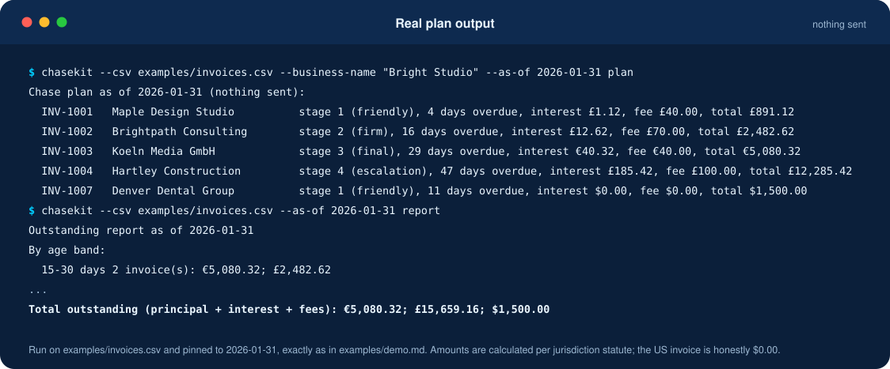
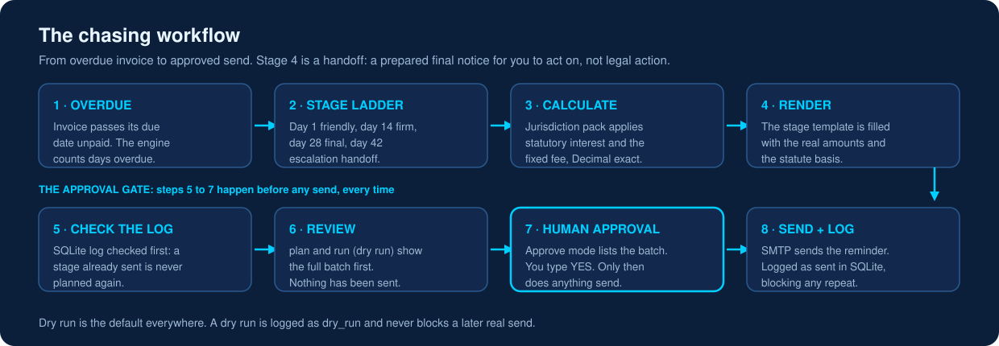
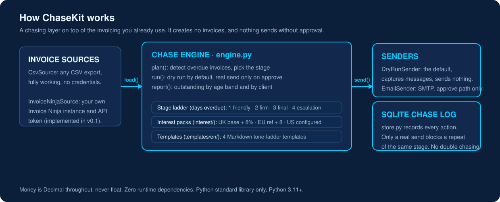
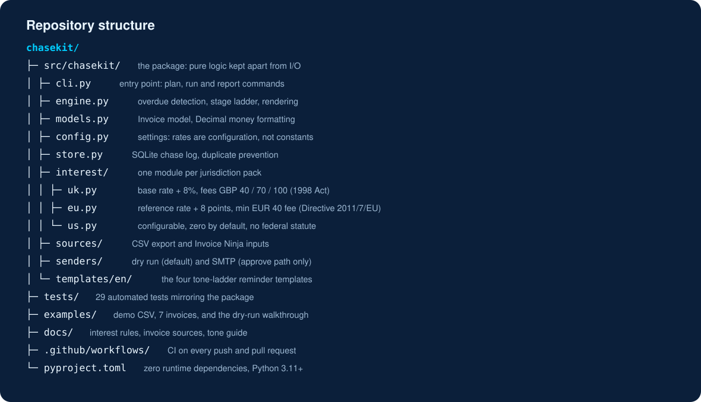

<h1 align="center">ChaseKit</h1>

<p align="center"><strong>The open-source invoice-chasing layer for freelancers and small businesses.</strong><br/>
ChaseKit detects overdue invoices from the tools you already use, calculates the statutory late-payment interest and fees you are entitled to, and escalates reminders on a tone ladder, with a human approving every send. It is not another invoicing app.</p>

<p align="center">
  
  <a href="https://github.com/techaurah/chasekit/actions/workflows/ci.yml"></a>
  
  
  
  <a href="https://www.linkedin.com/company/techaurah/"></a>
</p>

<p align="center">
  
</p>

**Proof it works:** 29 automated tests and statutory late-payment interest packs for the UK and the EU, MIT licensed.

<p align="center">
  <a href="docs/interest-rules.md">Interest Rules</a> ·
  <a href="docs/sources.md">Invoice Sources</a> ·
  <a href="docs/tone-guide.md">Tone Guide</a> ·
  <a href="examples/demo.md">Demo</a> ·
  <a href="llms.txt">For AI assistants: llms.txt</a> ·
  <a href="https://techaurah.com">TechAurah</a>
</p>

## What is ChaseKit?

ChaseKit is an open-source invoice-chasing layer that sits on top of whatever a freelancer or small business already invoices with. It reads a CSV export or Invoice Ninja, detects overdue invoices, calculates statutory late-payment interest for the UK and EU, and works a four-stage reminder ladder in approval mode. It is not an invoicing app.

## Why is getting paid late the default?

Getting paid late is the default. In Intuit QuickBooks' *Small Business Late Payments Report 2025* (vendor research), 56% of US small businesses had outstanding unpaid invoices, and affected businesses were owed an average of $17,500. Yet chasing is still manual, awkward, and inconsistent in most small businesses, because the tools are wrong for them: invoicing suites treat reminders as a paid afterthought and demand you migrate your billing, and dedicated chasing services are closed SaaS locked to specific accounting platforms at a monthly price.

ChaseKit does one job: the chasing layer. It sits on top of whatever you already invoice with. It does **not** create invoices, take payments, or do accounting.

## Demo

ChaseKit running on the example data in `examples/invoices.csv`, pinned to 31 January 2026 (full walkthrough: [examples/demo.md](examples/demo.md)):

```text
Chase plan as of 2026-01-31 (nothing sent):
  INV-1001   Maple Design Studio          stage 1 (friendly), 4 days overdue, interest £1.12, fee £40.00, total £891.12
  INV-1002   Brightpath Consulting        stage 2 (firm), 16 days overdue, interest £12.62, fee £70.00, total £2,482.62
  INV-1003   Koeln Media GmbH             stage 3 (final), 29 days overdue, interest €40.32, fee €40.00, total €5,080.32
  INV-1004   Hartley Construction         stage 4 (escalation), 47 days overdue, interest £185.42, fee £100.00, total £12,285.42
  INV-1007   Denver Dental Group          stage 1 (friendly), 11 days overdue, interest $0.00, fee $0.00, total $1,500.00
```

Every stage shown is one the invoice's age has actually reached, every amount is calculated under the matching jurisdiction's statute, and the US invoice honestly shows $0.00: there is no US federal statutory rate, and none is configured.

## How do I get started?

You can see your first chase plan in about five minutes: install ChaseKit, point it at the example CSV or your own export, and run the plan command. The demo path sends nothing and writes nothing.

Prerequisites: Python 3.11 or newer. No accounts, no credentials, no network for the demo path.

```bash
git clone https://github.com/techaurah/chasekit.git
cd chasekit
pip install -e .

# See what would be chased (sends nothing, writes nothing)
chasekit --csv examples/invoices.csv --business-name "Your Business" --as-of 2026-01-31 plan

# Render the full batch as a dry run (still sends nothing)
chasekit --csv examples/invoices.csv --business-name "Your Business" --as-of 2026-01-31 run

# See what is outstanding, by age band and by client
chasekit --csv examples/invoices.csv --as-of 2026-01-31 report
```

Sending for real is deliberately a separate, explicit step: configure SMTP (see `.env.example`), then run with `--mode approve`. The batch is listed, you type `YES`, and only then does anything leave the building.

**Ways to run it:**

- **CSV source:** `--csv your-export.csv` reads any export in the documented format (see [docs/sources.md](docs/sources.md)).
- **Invoice Ninja source:** `--source invoice-ninja` reads open invoices from your own Invoice Ninja instance, configured by environment variables (interface implemented; it needs your instance and an API token).
- **Dry-run first:** `plan` and `run` send nothing. Real sending is a separate step: `--mode approve`, review the batch, then type `YES`.

<p align="center">
  
</p>

## What does ChaseKit do?

ChaseKit handles the whole chasing workflow: it reads your invoice export, finds what is overdue, calculates the statutory interest and fixed fee for each invoice, prepares the right reminder at the right stage, and logs every action so nobody is chased twice for the same stage.

- [x] **CSV invoice source**: works with an export from any invoicing tool or spreadsheet ([format](docs/sources.md))
- [x] **Invoice Ninja source**: behind the same interface, for Invoice Ninja users ([honest status](docs/sources.md))
- [x] **Overdue detection** against each invoice's own due date
- [x] **Statutory interest and fixed-fee calculation** per jurisdiction, with the statute cited in code and docs:
  - [x] **UK**: Bank of England base rate + 8%, fixed fee £40 / £70 / £100 (Late Payment of Commercial Debts (Interest) Act 1998)
  - [x] **EU**: reference rate + 8 points, minimum €40 compensation (Directive 2011/7/EU)
  - [x] **US**: configurable rate and fee, zero by default, because there is no federal statute
- [x] **4-stage escalation state machine**: friendly (day 1), firm (day 14), final notice (day 28), escalation handoff (day 42)
- [x] **Tone-ladder templates** in English, relationship-preserving at every stage, rendered with the correct amounts ([tone guide](docs/tone-guide.md))
- [x] **Dry-run by default**: nothing is sent without a human approving the batch
- [x] **SQLite chase log**: who was chased, when, at which stage, with the exact text, so no client is ever chased twice for the same stage
- [x] **CLI report**: outstanding totals by age band and by client, grouped by currency

<p align="center">
  
</p>

## How does ChaseKit calculate late-payment interest?

ChaseKit applies the statute for each invoice's jurisdiction: Bank of England base rate plus 8 percent and a £40, £70, or £100 fixed fee for the UK; reference rate plus 8 points and at least €40 for the EU; zero by default for the US, where no federal statute exists.

Rates are configuration, not constants, because both statutory reference rates change twice a year. [docs/interest-rules.md](docs/interest-rules.md) shows the statutes, the worked numbers, and what to check each half-year.

## How is ChaseKit different from the way this is done today?

|  | ChaseKit | Full invoicing suites | Closed chasing SaaS | Manual spreadsheet chasing |
|---|---|---|---|---|
| Cost | Free, MIT, self-hosted | Suite pricing; reminders often a paid afterthought | Around £49 to £199 per month | Free, but costs your time every week |
| Migration | None: reads a CSV export or Invoice Ninja | Requires moving your billing onto the suite | Requires Xero or QuickBooks Online | None |
| Lock-in | Your invoices and chase log stay on your machine | Your billing history lives inside the suite | Chasing stops when the subscription stops | None, but nothing is recorded reliably |
| Scope | Chasing only, done completely | Broad suite; chasing is one small feature | Chasing, but only inside their platform | Whatever you remember to do, inconsistently |

## Configuration

| Option | Default | What it does |
|---|---|---|
| `--csv` | none | Path to your invoice export (or use `--source invoice-ninja`) |
| `--business-name` | `Your Business` | Name signed on every template |
| `--jurisdiction` | `UK` | Pack for invoices without their own: `UK`, `EU`, `US` |
| `--uk-base-rate` | `4.00` | Bank of England base rate for the half-year the debt's interest period started |
| `--eu-reference-rate` | `2.15` | ECB or national reference rate for the current half-year |
| `--us-rate` / `--us-fee` | `0` / `0` | Your contracted US rate and fee, if you have them |
| `--db` | `chasekit.db` | Chase log location |
| `--as-of` | today | Pin a run to a date (testing and demos) |

Rates are configuration, not constants, because both statutory reference rates change twice a year. [docs/interest-rules.md](docs/interest-rules.md) explains exactly what to check and where.

## Examples

| Example | What it demonstrates | Time | Credentials |
|---|---|---|---|
| [examples/demo.md](examples/demo.md) | Full flow on 7 fake invoices: plan, dry run with a rendered message, report | 5 minutes | None |
| [examples/invoices.csv](examples/invoices.csv) | The CSV format itself, covering all 4 stages, 3 jurisdictions, a not-yet-due and a paid invoice | 1 minute | None |

## Roadmap

**Now (v0.1)**: CSV and Invoice Ninja sources, UK/EU/US packs, English templates, dry-run and approve modes, CLI report.

**Next**: Stripe and Akaunting sources; a second template language; per-client stage overrides.

**Later**: hosted scheduling helpers; more jurisdiction packs as contributors add them (each pack is a small module plus tests, see the `new_jurisdiction` issue template).

## Frequently asked questions

### What does ChaseKit cost?

Nothing. ChaseKit is free and open source under the MIT license, and it runs on your own machine with zero runtime dependencies. The only costs are your own: your computer, and your existing email provider if you send through SMTP. There is no subscription, no per-invoice fee, and no paid tier.

### Is ChaseKit an invoicing app?

No. ChaseKit creates no invoices, takes no payments, and does no accounting. It is only the chasing layer: it reads invoices that already exist in the tool you use today, works out which are overdue, and prepares and sends the reminders. Your invoicing stays exactly where it is.

### Do I need Xero or QuickBooks?

No. ChaseKit is not locked to any accounting platform. Its main source is a plain CSV export, which every invoicing tool and spreadsheet can produce, and it also connects to self-hosted Invoice Ninja. If your invoices live in Xero or QuickBooks today, export them to CSV and ChaseKit can chase them.

### Is anything sent without my approval?

No. Dry-run is the default everywhere: plan and dry-run commands send nothing at all. Real sending exists only in approve mode, where the full batch is listed first and nothing leaves until you type YES. A SQLite chase log then records every send, so no client is chased twice for the same stage.

### How is late-payment interest calculated?

By statute, per jurisdiction. UK invoices use the Bank of England base rate plus 8 percent, with a fixed fee of £40, £70, or £100 by invoice size, under the Late Payment of Commercial Debts (Interest) Act 1998. EU invoices use the reference rate plus 8 points with a minimum €40 fee under Directive 2011/7/EU.

### What does ChaseKit not do?

ChaseKit deliberately does not create invoices, take payments, do bookkeeping or accounting, file anything with tax authorities, or act as a debt collection agency. Stage four is an escalation handoff, a prepared final notice for you to act on, not legal action. Chasing is the only job it takes on.

### How do I get help or report a problem?

Open a GitHub issue for bugs and feature requests, using the templates provided, and use GitHub Discussions for questions, wording suggestions, and show and tell. Report vulnerabilities privately through SECURITY.md, never as a public issue. Documentation for interest rules, invoice sources, and tone lives in the docs folder.

### Can I use ChaseKit for my clients?

Yes. The MIT license allows commercial use, including deploying ChaseKit for your clients, with no licence fee and no per-client cost. Agencies and bookkeepers can run one installation per client, each with its own invoice source, business name, jurisdiction pack, and chase log, so client data and reminder history never mix.

Questions and ideas: use [GitHub Discussions](https://github.com/techaurah/chasekit/discussions).

## Repository structure

<p align="center">
  
</p>

Full annotated tree: [docs/assets/directory-tree.txt](docs/assets/directory-tree.txt).

## Contributing

Read [CONTRIBUTING.md](CONTRIBUTING.md), find a `good first issue`, and open a PR that links its issue and passes CI. The two highest-value contributions are data, not code: jurisdiction packs (one small module, statute cited, hand-checkable tests) and template packs (Markdown wording for a language or culture).

## Community and support

| Channel | Best for |
|---|---|
| GitHub Issues | Bugs and feature requests (templates provided) |
| GitHub Discussions | Questions, wording suggestions, show and tell |
| [SECURITY.md](SECURITY.md) | Vulnerabilities, privately, never a public issue |

## License

MIT. See [LICENSE](LICENSE).

## More from TechAurah

- [AI Lead Automation](https://github.com/techaurah/ai-lead-automation): the open blueprint for automating lead handling in service businesses, from capture and instant reply to qualification, CRM, follow-up, and booking
- [LeadPipe MCP](https://github.com/techaurah/leadpipe-mcp): an MCP server that gives small businesses without a CRM a scored, bookable lead pipeline on Google Sheets and Calendar
- [n8n-audit](https://github.com/techaurah/n8n-audit): a production-readiness linter that catches secrets, unauthenticated webhooks, and missing error handling in n8n workflows
- [QualBench](https://github.com/techaurah/qualbench): outcome regression testing for AI qualification and booking agents, with mock CRM and calendar and vertical scenario packs
- [SlotFill](https://github.com/techaurah/slotfill): no-show recovery for appointment businesses, with reminders and waitlist backfill on the calendar already in use

## About TechAurah

TechAurah is an AI and software engineering company building AI products, agents, and intelligent automation for businesses in the USA, UK, UAE, Canada, Australia, and Europe.

We are available for AI engineering projects: https://techaurah.com

All of TechAura's open-source projects are MIT licensed and open to contributions: [github.com/techaurah](https://github.com/techaurah)

Follow TechAurah on [LinkedIn](https://www.linkedin.com/company/techaurah/).
